<div align="center">

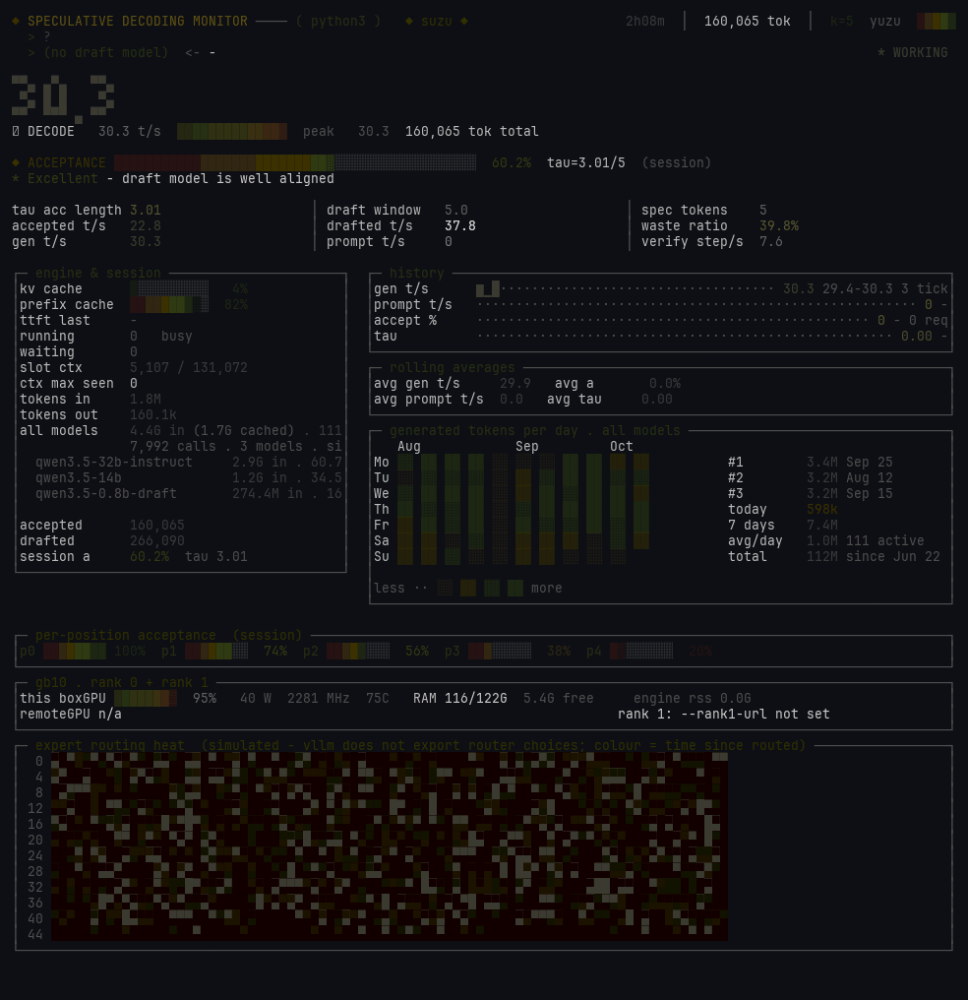

# suzu ·鈴

**A small bell for your LLM engine.**
A live terminal panel for local inference — speculative decoding, throughput,
KV cache, tokens/day — in **one dependency-free Python file**.

`pip install` nothing · `python3 suzu.py --port 30001` · stdlib only

</div>

---

suzu watches a local inference engine over HTTP and draws what it sees: per-slot
live token rate, prefill vs prompt-cache split, speculative-decoding acceptance
with per-position bars, expert heat map, GPU / VRAM / watts, and an optional
GitHub-style heatmap of tokens generated per day.

It was born watching **speculative decoding**, where the interesting numbers
(draft acceptance, tau, per-position acceptance) only appear if you look
precisely — and where most monitors silently show you stale data. suzu doesn't.

- **One file, zero dependencies** — `urllib`, `json`, `re`, `subprocess`, `termios`.
  No curses, no rich, no textual: raw ANSI into the alternate screen buffer,
  redraws on `SIGWINCH`, single-key controls.
- **Resizes like btop** — drag the terminal anywhere and the layout re-decides
  every frame: big digits collapse to a stat line, the engine box sheds its
  luxuries, history compacts, the heatmap folds away. Boxes shrink instead of
  getting cut mid-border.
- **Honest about engines** — every engine exposes a different slice of the truth.
  suzu shows what's live, reconstructs what's closed, and *tells you which is which*.
- **Multi-engine by design** — llama.cpp, vLLM, TabbyAPI/ExLlamaV3, TensorFold,
  and anything OpenAI-compatible (process strip), each via a small adapter.

## Try it in 30 seconds — no GPU, no model

The repo ships a synthetic engine that speaks llama.cpp's wire format,
speculative decoding included — plus a generator for synthetic token-usage
history, so the Token Gen heatmap renders too:

```bash
python3 demo/fake_engine.py --port 8099                       # terminal 1: a fake engine
python3 demo/fake_tokens.py --out demo-tokens.db              # optional: fake usage history
python3 suzu.py --port 8099 --tokens-db demo-tokens.db        # terminal 2: the bell
```

You'll see a full prefill → decode → idle cycle with draft/acceptance counters,
exactly as a real server behaves — including the quirk that shaped suzu's
design: `/metrics` counters that only move at request close.

## Point it at a real engine

```bash
curl -fLo suzu https://raw.githubusercontent.com/GaelicThunder/suzu/main/suzu.py
chmod +x suzu
./suzu --port 30001        # whatever port your engine listens on
```

```
keys:  t = cycle theme   l = toggle log   L/g = layer grid
       p = performance zoom   b = token pipeline   q = quit
```

## Views

| | |
|---|---|
| 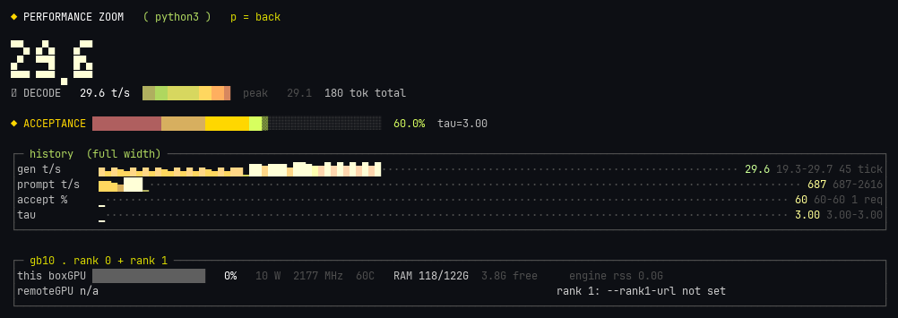 | 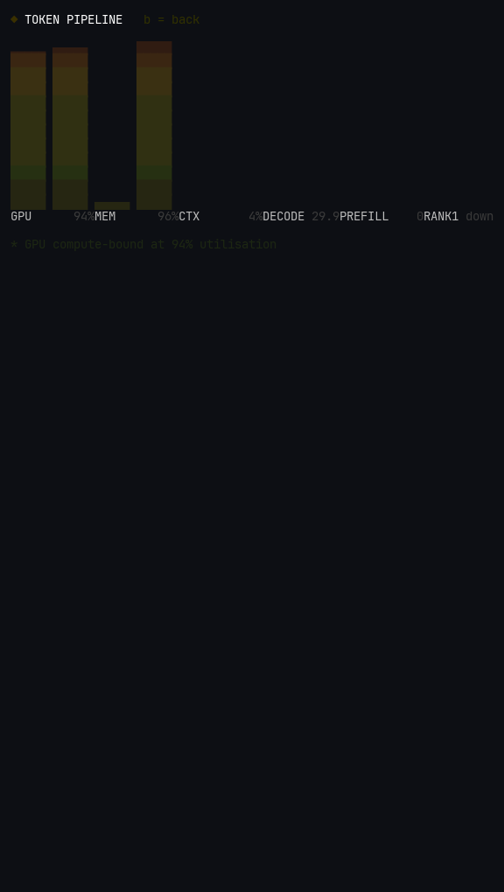 |
| **`p` — performance zoom**: full-width history, per-rank GPU/RAM/link rows | **`b` — token pipeline**: vertical VU meters + bottleneck verdict |
| 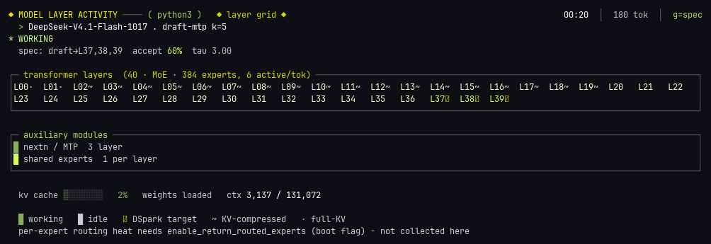 | |
| **`g` — layer grid**: real model topology, per-layer activity, expert counts | |

## Engines

suzu speaks several engines natively and degrades honestly where an engine
exposes less:

| Engine | Live tokens | Spec / acceptance | KV cache | How |
|---|---|---|---|---|
| llama.cpp (`llama-server`) | ✔ | ✔ draft/accept, per-position | ✔ | `/slots` + `/metrics` |
| vLLM | ✔ | ✔ spec-decode counters | – | `/metrics`, TP ranks via `--rank1-url` |
| TabbyAPI / ExLlamaV3 | ✔ | – | – | synthesized from `/props` + engine log |
| TensorFold | ✔ | tokens/round | – | synthesized from `/metrics` + SSE events |
| any OpenAI-compatible server | – | – | – | process strip only (cmdline via `ps`) |

"Synthesized" means suzu rebuilds the same panel keys from whatever the engine
*does* expose — closed counters from `/metrics`, in-flight tokens from SSE or
the log — instead of showing nothing. The panel labels which parts are live and
which are reconstructed.

### The measurement that shapes the design

llama.cpp's `/metrics` counters **do not move during a generation** — they are
flushed at request completion. Measured on a live slot: 6.2 s of active decoding
produced a delta of **0** on every `/metrics` counter. A 1 s monitor built on
`/metrics` alone reads "0 tok/s" for minutes under full load. So suzu splits
its sources:

- live rate and prefill from `/slots` (`next_token.n_decoded`, advances every token)
- acceptance, tau, per-position bars from `/metrics`, **shown with the age of
  the last closed request** rather than passed off as instantaneous
- KV/prefix cache from `/slots`, which llama.cpp exposes nowhere else

If your engine flushes at request close too, suzu will not lie to you about it.

## Token Gen (optional)

A GitHub-contribution-style heatmap of **tokens generated per day** across all
models — `--tokens-db PATH` (default `~/.hermes/state.db`, the schema written by
[Hermes Agent](https://github.com/NousResearch/hermes-agent): tables
`session_model_usage` / `session_model_usage_v21`). Missing file or tables and
the row simply doesn't appear. Anyone running Hermes gets the graph for free;
everyone else loses nothing — or runs `demo/fake_tokens.py` for a synthetic one.

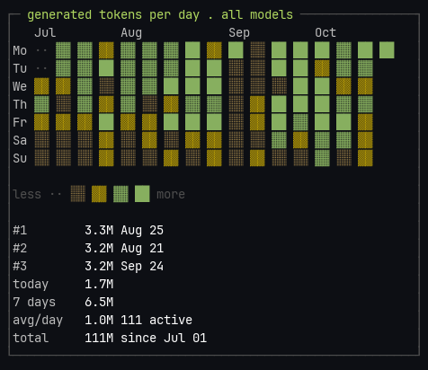

## Multi-node and gateways

```bash
./suzu --port 30001 \
       --rank1-url http://100.x.y.z:8888/metrics \   # second TP rank / drafter box
       --lanes-url http://127.0.0.1:30001/yzq/stats  # optional gateway queue view
```

Unset by default; unreachable renders a plain `rank 1: unreachable` row, never
a crash. The lanes row shows the queue you actually sit in — which `/metrics`
cannot see, because a gateway answers before its scheduler ever touches the engine.

## Themes

`t` cycles live; `--theme NAME` picks one; `--list-themes` lists all eleven. The
default `yuzu` theme is the warm one above; `neon` is the classic forum-panel look;
`phosphor` is the green/amber EVA-style CRT, with its own phosphor ramps.

| yuzu | neon | matrix | amber | ice |
|---|---|---|---|---|
| 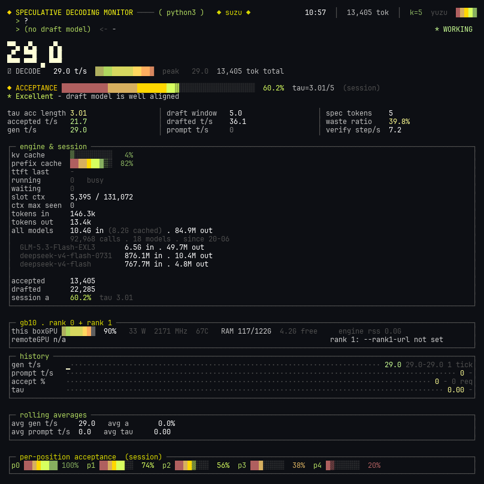 | 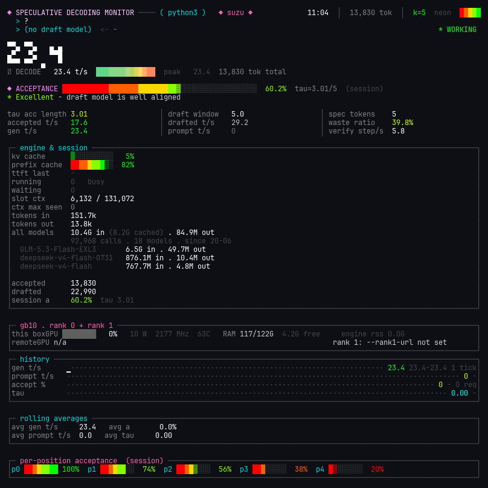 | 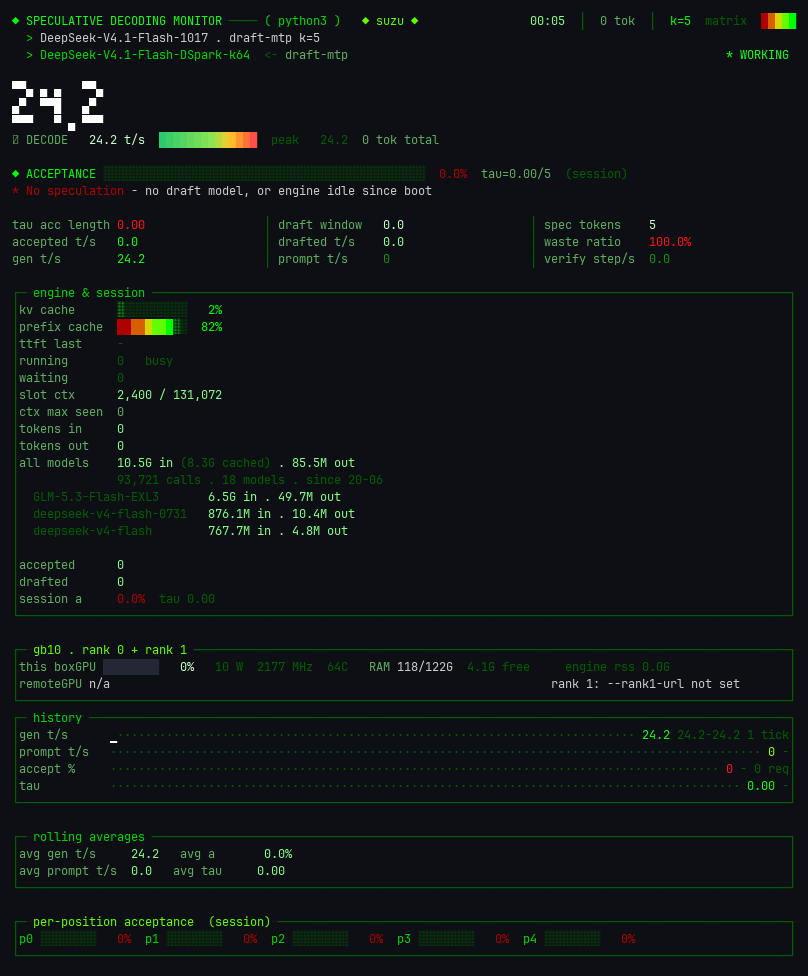 | 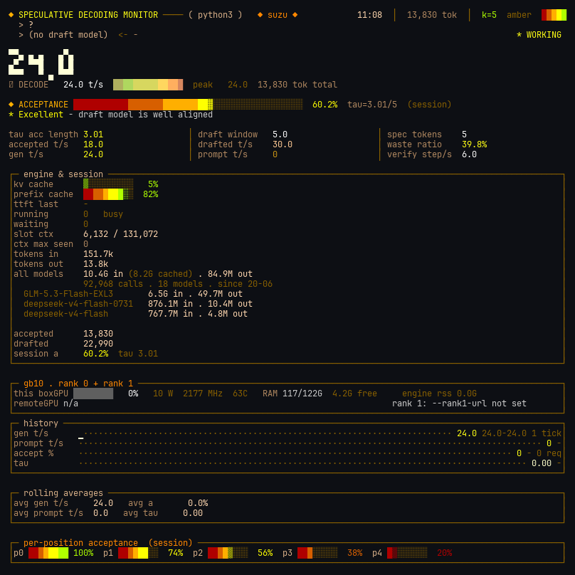 | 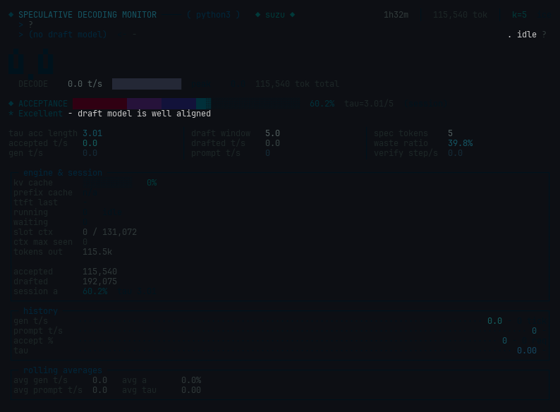 |
| **grape** | **sunset** | **oxide** | **vapor** | **paper** |
| 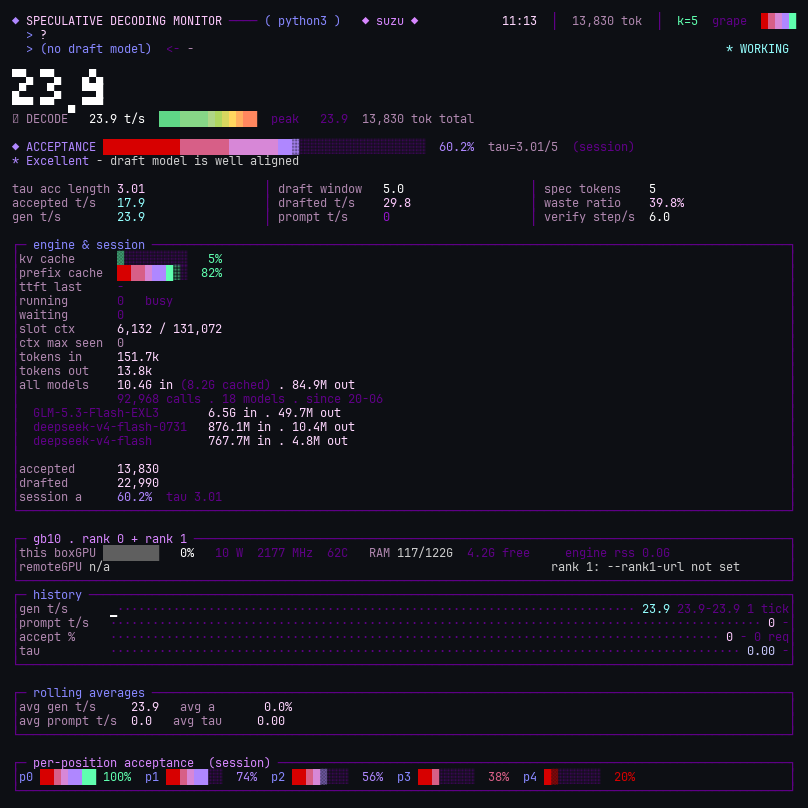 | 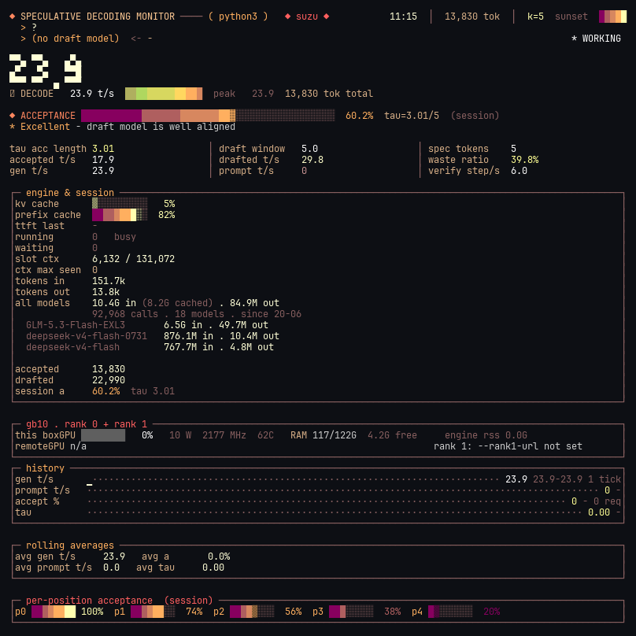 | 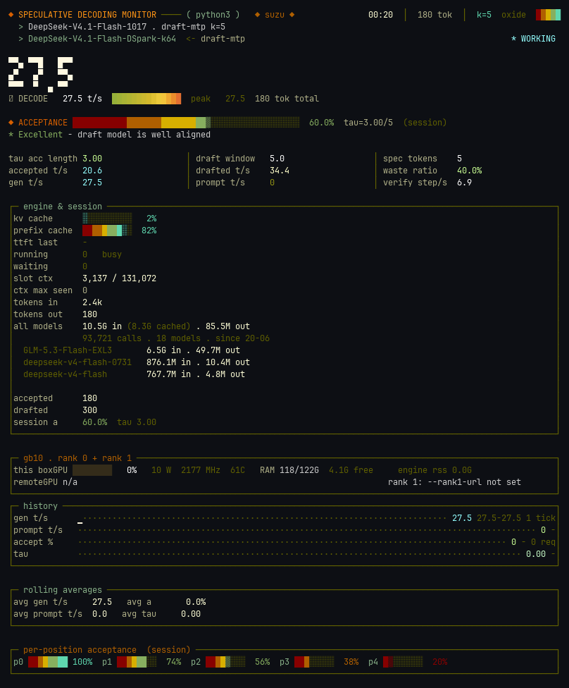 | 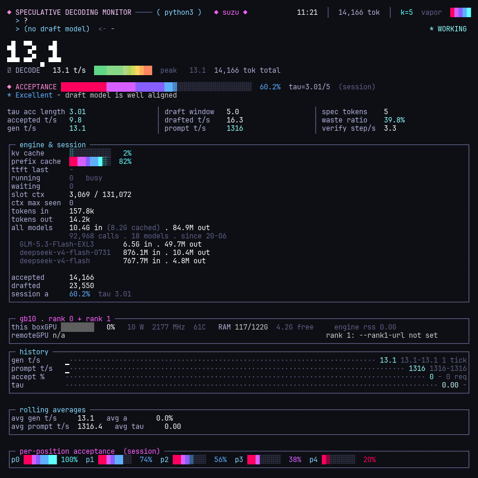 | 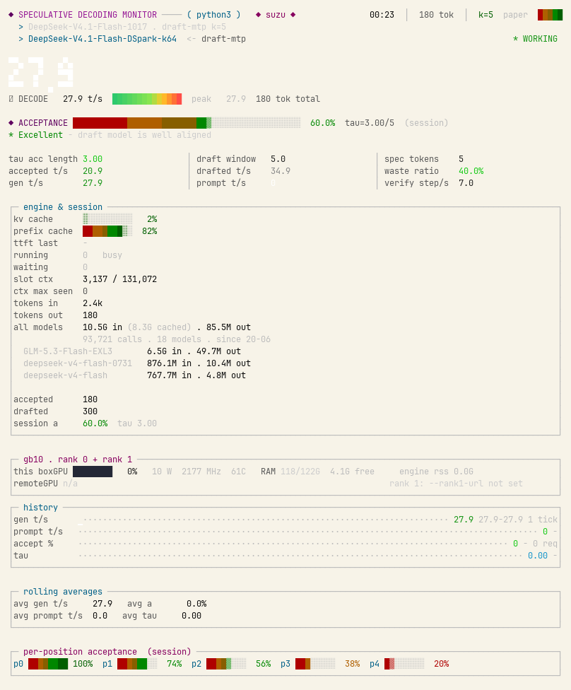 |

Color depth auto-detects (truecolor / 256); `--color truecolor|256|auto` forces it.
Themes persist to `~/.config/suzu/theme` (`SUZU_THEME` overrides the path).

## Adding an engine

Every supported engine is an adapter of ~100 lines mapping your endpoints onto
the shared panel keys — see `suzu/fetch/` (one module per engine) and
`ARCHITECTURE.md` for the map and the recipe. `test_suzu.py` is an offline
harness that drives the adapters against a synthetic engine (100+ checks, no
server needed). If your engine exposes `/metrics` or a log line, suzu can show
it. PRs welcome.

## Development

`suzu/` is the source; `suzu.py` is generated, so edit the package, not the
release file:

```bash
python3 tools/bundle.py     # rebuild suzu.py
python3 test_suzu.py        # offline suite, exit 0 = all good
```

`ARCHITECTURE.md` has the module map, one tick's data flow, the laws the tests
enforce, and how to add an engine, a theme or a panel.

## Provenance

suzu is the public single-file release of an internal monitor built on a
two-box GB10 cluster. The full-screen speculative-decoding panel idea comes
from a dashboard posted in the NVIDIA DGX Spark forum; the 2026-09 rework
borrowed visual ideas (half-block big digits, VU gauges with peak-hold,
attack/release fade, expert heat map) from
[DingoOz/llm-visuals](https://github.com/DingoOz/llm-visuals) (MIT).
It is a reimplementation, not a fork — no upstream code is vendored.

## License

[MIT](LICENSE) © 2026 GaelicThunder
